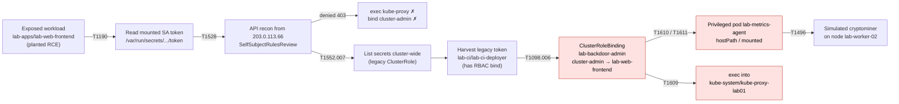

# Lab Incident: Kubernetes Service Account Compromise to Cryptominer

> [!IMPORTANT]
> **LAB SIMULATION.** This is a constructed training scenario, not a real incident.
> The cluster, namespaces, identities, IP addresses (RFC 5737), registry
> (`registry.example.net`, RFC 2606), and timeline are synthetic. It describes no
> real organization, employer, or client, and reports no real-world metrics.
> The misconfigurations were introduced deliberately to exercise the detections
> in this repository.

| | |
|---|---|
| **Scenario ID** | `2026-lab-k8s-service-account-compromise` |
| **Environment** | Single-cluster lab (Kubernetes v1.31, API server audit logging enabled) |
| **Severity (lab rating)** | High: cluster-admin obtained, node-level access, unauthorized compute use |
| **Detections exercised** | 3 Kubernetes audit rules in [`detections/sigma/kubernetes/audit/`](../../detections/sigma/kubernetes/audit) |
| **Evidence** | Synthetic audit events in [`tests/data/k8s_*`](../../tests/data) (the `Lab incident step` samples) |

## 1. Summary

An internet-exposed lab web workload (`lab-apps/lab-web-frontend`) contained a
deliberately planted remote-code-execution flaw. The simulated attacker used it to
read the pod's mounted service account token and called the Kubernetes API from
outside the cluster. Two direct escalation attempts were denied. The attacker then
used an over-broad legacy ClusterRole to list secrets cluster-wide and harvested a
long-lived token for a CI service account that had RBAC `bind` rights. With that
token, the attacker bound `cluster-admin` back to the original foothold service
account. They then deployed a privileged pod mounting the node's root filesystem,
which ran a simulated cryptominer, and exec'd into a `kube-system` pod to look for
node credentials.

All three Kubernetes detections in this repo match the attacker's escalation,
deployment, and hands-on-keyboard steps. The initial exploit, the token theft, and
the cluster-wide secret listing were **not** covered by any repo detection; they are
listed as detection gaps in section 9.

## 2. Attack flow



Red nodes mark steps where a repo detection matched.

## 3. Synthetic timeline (UTC, 2026-10-14)

| Time (UTC) | Actor | Event | Detection |
|---|---|---|---|
| 01:47:10 | External `203.0.113.66` | Planted RCE in `lab-web-frontend` exploited via its public LoadBalancer | None (gap) |
| 01:52:31 | Attacker in pod | Reads the auto-mounted service account token | None (gap) |
| 02:03:18 | `system:serviceaccount:lab-apps:lab-web-frontend` from `203.0.113.66` (`curl/8.5.0`) | `SelfSubjectRulesReview` enumerates permissions | None (gap) |
| 02:09:40 | same | `pods/exec` into `kube-system/kube-proxy-lab01`, **403 Forbidden** | Excluded by design (denied) |
| 02:11:03 | same | Create `ClusterRoleBinding lab-backdoor-admin` → `cluster-admin`, **403 Forbidden** | Excluded by design (denied) |
| 02:14:27 | same | `list secrets` across all namespaces, allowed by leftover ClusterRole `lab-legacy-secret-reader` | None (gap) |
| 02:15:02 | Attacker | Extracts legacy `kubernetes.io/service-account-token` secret for `lab-ci/lab-ci-deployer` | None (gap) |
| 02:19:42 | `system:serviceaccount:lab-ci:lab-ci-deployer` | Creates `ClusterRoleBinding lab-backdoor-admin`: `cluster-admin` → SA `lab-apps/lab-web-frontend`, **201** | **Rule A** |
| 02:24:57 | `lab-web-frontend` (now cluster-admin) | Creates pod `lab-apps/lab-metrics-agent`, `privileged: true`, `hostPath: /`, **201** | **Rule B** |
| 02:26:40 | Pod on `lab-worker-02` | Simulated miner starts; outbound connection to `198.51.100.200:3333` | None (outside audit-log scope) |
| 02:31:15 | `lab-web-frontend` | `pods/exec` into `kube-system/kube-proxy-lab01` (SPDY), **101 Switching Protocols** | **Rule C** |
| 02:38:00 | Lab analyst | Triage begins from the Rule A notable (section 5) | |
| 02:52:00 | Lab analyst | Containment complete (section 6) | |

> The timeline is fabricated for the exercise. Detection timing depends on how
> the SPL runs (scheduled or real-time search) and is not a measured result.

## 4. How each repo detection fired

Validation method: the attacker's audit events are committed as synthetic samples.
The repo's pytest suite (`make test`) evaluates each Sigma rule against them in
CI, and the SPL is generated from the same rules. The SPL was **not** run against a
live Splunk instance as part of this write-up.

### Rule A: ClusterRoleBinding grants cluster-admin to a non-system subject (T1098.006, high)

- **Rule:** [`k8s_cluster_admin_binding_to_non_system_subject.yml`](../../detections/sigma/kubernetes/audit/k8s_cluster_admin_binding_to_non_system_subject.yml)
- **Matching event:** [`tp_harvested_ci_token_binds_cluster_admin_to_foothold_sa.json`](../../tests/data/k8s_cluster_admin_binding_to_non_system_subject/true_positive/tp_harvested_ci_token_binds_cluster_admin_to_foothold_sa.json)
- **Why it matched:** `verb=create`, `objectRef.resource=clusterrolebindings`, `roleRef.name=cluster-admin`, `responseStatus.code=201`. The subject is `ServiceAccount lab-apps/lab-web-frontend`: its name has no `system:` prefix and its namespace is not `kube-system`.
- **Why the 02:11 attempt did not match:** response code 403. Denied attempts are excluded to keep the rule high-fidelity; they remain visible to hunting (section 5).

### Rule B: Privileged pod or hostPath mount outside kube-system (T1610, T1611, high)

- **Rule:** [`k8s_privileged_pod_or_hostpath_outside_kube_system.yml`](../../detections/sigma/kubernetes/audit/k8s_privileged_pod_or_hostpath_outside_kube_system.yml)
- **Matching event:** [`tp_privileged_hostpath_miner_pod.json`](../../tests/data/k8s_privileged_pod_or_hostpath_outside_kube_system/true_positive/tp_privileged_hostpath_miner_pod.json)
- **Why it matched:** `create pods` with code 201 in `lab-apps`. Two conditions were true at once: container `agent` has `securityContext.privileged: true`, and volume `host-root` is `hostPath: /`.

### Rule C: Exec into a pod in kube-system (T1609, medium)

- **Rule:** [`k8s_exec_into_kube_system_pod.yml`](../../detections/sigma/kubernetes/audit/k8s_exec_into_kube_system_pod.yml)
- **Matching event:** [`tp_exec_into_kube_proxy_spdy.json`](../../tests/data/k8s_exec_into_kube_system_pod/true_positive/tp_exec_into_kube_proxy_spdy.json)
- **Why it matched:** `objectRef.subresource=exec`, `objectRef.namespace=kube-system`, `verb=create` (SPDY), code 101. The 02:09 attempt (403) was excluded as denied.

### Not applicable

The two AWS CloudTrail rules in this repo do not apply: the lab cluster is
self-managed, and no AWS IAM activity was part of the scenario.

## 5. Triage

1. **Confirm the alert.** Pull the full binding object and who created it:
   ```spl
   sourcetype="kube:apiserver:audit" objectRef.resource="clusterrolebindings" objectRef.name="lab-backdoor-admin"
   | table requestReceivedTimestamp, verb, user.username, sourceIPs{}, userAgent, responseStatus.code, requestObject.subjects{}.name
   ```
2. **Scope the creator and the beneficiary.** Both service accounts are suspect: `lab-ci-deployer` created the binding and `lab-web-frontend` received it. Pivot on both, plus the source IP:
   ```spl
   sourcetype="kube:apiserver:audit" earliest="10/14/2026:00:00:00"
       (user.username="system:serviceaccount:lab-ci:lab-ci-deployer"
        OR user.username="system:serviceaccount:lab-apps:lab-web-frontend"
        OR sourceIPs{}="203.0.113.66")
   | stats count values(verb) as verbs values(responseStatus.code) as codes by user.username, objectRef.resource, objectRef.namespace
   ```
3. **Red flags in the results:**
   - In-cluster service account tokens used from an external IP with a `curl` user agent.
   - 403s followed by a successful escalation.
   - `list secrets` with no namespace (cluster-wide).
4. **Establish what was created after escalation:** the pods, bindings, and exec sessions by either identity after 02:19:42. That surfaces the `lab-metrics-agent` pod (Rule B) and the kube-proxy exec (Rule C).
5. **Assess blast radius.**
   - Every secret returned by the 02:14 cluster-wide list is treated as exposed.
   - Node `lab-worker-02` (where the privileged hostPath pod ran) is treated as compromised.
6. **Classify:** confirmed malicious. Escalate to containment.

## 6. Containment

Ordered so that credentials are cut first and evidence is captured before deletion.

1. **Remove the escalation path.** Export the binding as evidence, then delete it:
   ```bash
   kubectl get clusterrolebinding lab-backdoor-admin -o yaml > evidence/lab-backdoor-admin.yaml
   ```
   ```bash
   kubectl delete clusterrolebinding lab-backdoor-admin
   ```
2. **Invalidate stolen credentials.**
   - Delete the legacy token secret for `lab-ci-deployer`. Legacy secret-based tokens stop working when their secret is deleted.
   - The stolen `lab-web-frontend` token is a pod-bound projected token, so it is invalidated when its pod is deleted (step 4).
3. **Isolate the node.** Cordon `lab-worker-02` and apply a deny-all egress NetworkPolicy to `lab-apps`. This cuts the miner's pool connection while keeping the node available for forensics.
4. **Remove the attacker's workloads.** Capture `kubectl get pod lab-metrics-agent -n lab-apps -o yaml` and container logs, then delete the pod. Scale `lab-web-frontend` to zero until it is patched; this also deletes the pods holding the bound token.
5. **Remove the original over-permission.** Delete the leftover `lab-legacy-secret-reader` ClusterRole and its binding.

## 7. Eradication

- **Rebuild, don't clean, the node.** A privileged container with the host root filesystem mounted could have modified the kubelet, container runtime, or host binaries. Drain `lab-worker-02` and replace it from a known-good image.
- **Rotate exposed secrets.** Rotate every secret readable at 02:14 (cluster-wide list), starting with credentials for systems outside the cluster.
- **Remove legacy token secrets cluster-wide.** Replace them with short-lived projected tokens, and use the `LegacyServiceAccountTokenCleanUp` controller (Kubernetes 1.29+) to purge unused ones.
- **Fix the planted RCE** in `lab-web-frontend` and rebuild its image.
- **Review RBAC for other `bind`/`escalate` grants.** Check every ClusterRoleBinding to `cluster-admin` against the approved list.

## 8. Recovery

1. Redeploy `lab-web-frontend` from the patched image with `automountServiceAccountToken: false`. The workload does not call the Kubernetes API.
2. Label `lab-apps` and `lab-ci` with Pod Security Admission `enforce: restricted` before allowing workloads back.
3. Restore ingress through the load balancer only after the NetworkPolicies in section 9 are in place.
4. Watch for recurrence. Keep Rules A–C enabled, and run the section 5 hunting query for the attacker IP and identities on a schedule.

## 9. Lessons learned and hardening

### Detection gaps found (candidate rules for this repo)

| Gap | Proposed detection |
|---|---|
| Service account token used from outside the cluster network | Audit events where `user.username` starts with `system:serviceaccount:` and `sourceIPs{}` falls outside the pod/node CIDRs |
| Cluster-wide secret enumeration | `verb=list`, `objectRef.resource=secrets`, no `objectRef.namespace`, by a non-system identity |
| Repeated 403s followed by success | Correlation search: N denied RBAC-sensitive requests, then a 2xx on the same resource by the same source |
| Miner network and CPU behavior | Outside API audit logs; needs runtime or network telemetry |

### RBAC

- No workload service account should hold `list`/`watch` on `secrets` cluster-wide, or the `bind`, `escalate`, or `impersonate` verbs.
- Set `automountServiceAccountToken: false` by default, and opt in per workload.
- Keep CI identities out of the cluster's RBAC plane where possible. Where they need access, scope it to namespaces with Roles, not ClusterRoles.
- Run a periodic review of all bindings to `cluster-admin` and other high-privilege roles.

### Pod Security Admission: restricted

The `restricted` profile rejects privileged containers and hostPath volumes at
admission, so the Rule B pod would have been blocked (the 403 case in
[`benign_privileged_pod_rejected_by_psa.json`](../../tests/data/k8s_privileged_pod_or_hostpath_outside_kube_system/benign/benign_privileged_pod_rejected_by_psa.json)).

```yaml
apiVersion: v1
kind: Namespace
metadata:
  name: lab-apps
  labels:
    pod-security.kubernetes.io/enforce: restricted
    pod-security.kubernetes.io/enforce-version: latest
    pod-security.kubernetes.io/warn: restricted
    pod-security.kubernetes.io/audit: restricted
```

### Network policy

Default-deny in application namespaces, then allow only what each workload needs.
In this scenario, default-deny egress would have blocked the miner's outbound pool
connection. It would not have stopped the stolen token from being used, because the
attacker called the API server from outside the cluster (see "API server exposure").

```yaml
apiVersion: networking.k8s.io/v1
kind: NetworkPolicy
metadata:
  name: default-deny-all
  namespace: lab-apps
spec:
  podSelector: {}
  policyTypes: ["Ingress", "Egress"]
```

Add an explicit policy for DNS egress and for each required ingress or egress flow.

### Audit policy

Rules A and B need the request body (`requestObject`); Rule C needs only metadata.
Secrets must never be logged above `Metadata` level, or the audit log becomes a
credential store. The first matching rule wins, so order matters:

```yaml
apiVersion: audit.k8s.io/v1
kind: Policy
omitStages: ["RequestReceived"]
rules:
  # Never log secret or token bodies.
  - level: Metadata
    resources:
      - group: ""
        resources: ["secrets", "configmaps", "serviceaccounts/token"]
  # RBAC changes with full request/response (Rule A).
  - level: RequestResponse
    resources:
      - group: "rbac.authorization.k8s.io"
        resources: ["clusterrolebindings", "rolebindings", "clusterroles", "roles"]
  # Pod specs on write (Rule B).
  - level: Request
    verbs: ["create", "update", "patch"]
    resources:
      - group: ""
        resources: ["pods"]
  # Interactive access (Rule C).
  - level: Metadata
    resources:
      - group: ""
        resources: ["pods/exec", "pods/attach", "pods/portforward", "pods/ephemeralcontainers"]
  # Everything else at metadata level.
  - level: Metadata
```

### API server exposure

The API server accepted requests from an external address. Restrict it to
administrator networks and in-cluster ranges (firewall or authorized networks), so
a stolen token alone is not enough to reach it from the internet.

## 10. MITRE ATT&CK mapping

| Tactic | Technique | Scenario step | Repo detection |
|---|---|---|---|
| Initial Access | [T1190](https://attack.mitre.org/techniques/T1190/) Exploit Public-Facing Application | Planted RCE in `lab-web-frontend` | None (gap) |
| Credential Access | [T1528](https://attack.mitre.org/techniques/T1528/) Steal Application Access Token | Read mounted SA token | None (gap) |
| Discovery | [T1613](https://attack.mitre.org/techniques/T1613/) Container and Resource Discovery | `SelfSubjectRulesReview`, resource listing | None (gap) |
| Credential Access | [T1552.007](https://attack.mitre.org/techniques/T1552/007/) Unsecured Credentials: Container API | Cluster-wide secret list; harvest `lab-ci-deployer` token | None (gap) |
| Privilege Escalation, Persistence | [T1098.006](https://attack.mitre.org/techniques/T1098/006/) Additional Container Cluster Roles | `lab-backdoor-admin` → `cluster-admin` | **Rule A** |
| Execution | [T1610](https://attack.mitre.org/techniques/T1610/) Deploy Container | `lab-metrics-agent` pod | **Rule B** |
| Privilege Escalation | [T1611](https://attack.mitre.org/techniques/T1611/) Escape to Host | `privileged: true` + `hostPath: /` | **Rule B** |
| Execution | [T1609](https://attack.mitre.org/techniques/T1609/) Container Administration Command | exec into `kube-proxy-lab01` | **Rule C** |
| Impact | [T1496](https://attack.mitre.org/techniques/T1496/) Resource Hijacking | Simulated cryptominer | None (outside audit-log scope) |
