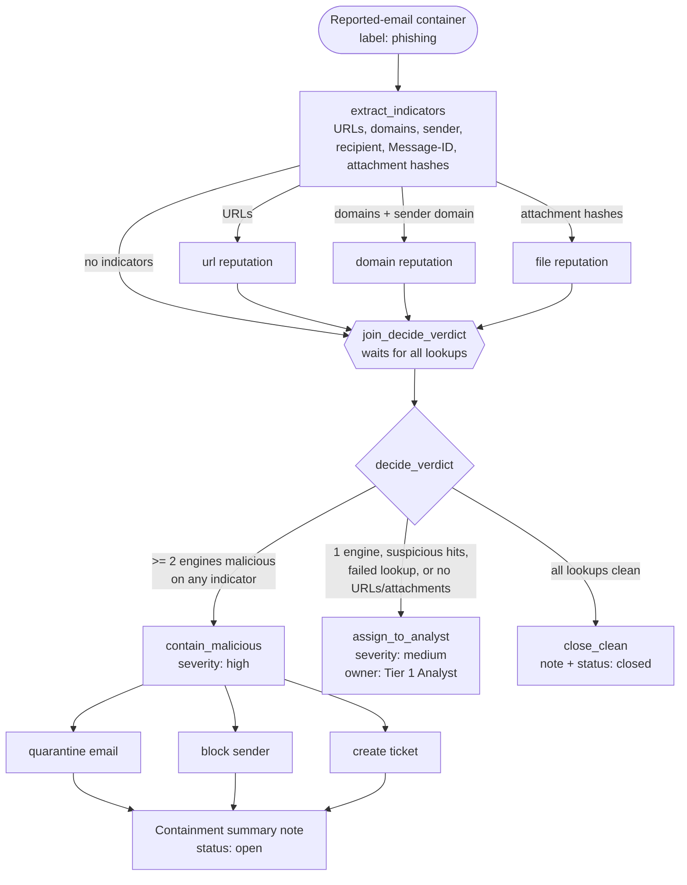

# Phishing Triage: Splunk SOAR Playbook

Automated triage for user-reported phishing emails. The playbook extracts
indicators, scores them with reputation lookups, and routes the email to one of
three outcomes: automatic containment, analyst review, or auto-close.

> **Lab simulation.** This playbook was built and tested offline against
> synthetic containers and mocked reputation results. It is not a record of any
> production deployment or real incident. Asset names are lab placeholders, and
> no credentials or API keys are in the code (SOAR stores credentials on the asset).

## Flow



## Decision logic

`classify()` is a pure function, so it is unit-tested directly. Rules are applied in order:

| # | Condition | Verdict | Outcome |
|---|---|---|---|
| 1 | Any indicator flagged malicious by `MALICIOUS_THRESHOLD` (default 2) or more engines | **malicious** | Quarantine message, block sender, create ticket |
| 2 | No URLs and no attachments (text-only / BEC-style lure) | **suspicious** | Assign to analyst; a clean sender domain alone never auto-closes |
| 3 | Any detection below threshold, any `suspicious` hit, or any failed/empty lookup | **suspicious** | Assign to analyst |
| 4 | Every lookup returned zero detections | **clean** | Note and auto-close |

Design choices:

- **Fail safe.** A failed lookup routes the email to a human; the playbook never auto-closes on an error.
- **High bar for automatic containment.** One engine is not enough to pull mail from an inbox. Tune `MALICIOUS_THRESHOLD` to your reputation sources.
- **Degraded containment is recorded.** If the Message-ID or recipient is missing, quarantine is skipped, sender block and ticket still run, and the containment note lists what was skipped.
- **Single decision.** Reputation actions run in parallel. The join function is guarded with `phantom.completed()` plus a run-data flag so the decision runs exactly once.

## Configuration

All tunables are at the top of [`phishing_triage.py`](phishing_triage.py):

| Setting | Default | Purpose |
|---|---|---|
| `ASSETS` | `lab_threat_intel`, `lab_mail_server`, `lab_ticketing` | SOAR asset names per action type |
| `MALICIOUS_COUNT_PATH` / `SUSPICIOUS_COUNT_PATH` | `action_result.summary.malicious` / `.suspicious` | Where your reputation app reports detection counts; map these to your app's output |
| `MALICIOUS_THRESHOLD` | `2` | Engines required for automatic containment |
| `ANALYST_ROLE` | `Tier 1 Analyst` | Role assigned for manual review |
| `ARTIFACT_DATAPATHS` | `cef.requestURL`, `cef.destinationDnsDomain`, `cef.fromEmail`, `cef.toEmail`, `cef.emailHeaders.Message-ID`, `cef.fileHashSha256`, `cef.fileHash` | CEF fields from email ingestion |

Actions used: `url reputation`, `domain reputation`, `file reputation`,
`quarantine email`, `block sender`, `create ticket`. Action names and parameter
keys vary by app. Check each app's documentation and adjust the `phantom.act()`
parameters to match.

## Importing into Splunk SOAR

Menu labels below are for Splunk SOAR 6.x; confirm them against your version's documentation.

**Option A: source control (recommended for detection-as-code)**

1. **Main Menu → Administration → Product Settings → Source Control**, then configure this repo (or a fork) as a playbook repository.
2. SOAR stores each playbook as a `.py` + `.json` pair. The `.json` metadata is generated by SOAR, so create the playbook once (Option B), save it, and let SOAR write the pair back to the repo.

**Option B: create in the editor**

1. **Main Menu → Playbooks → + Playbook**, then choose an automation playbook.
2. Switch the editor to full-code (Python) mode, paste the contents of `phishing_triage.py`, and save.
3. In playbook settings, set **Operates on** to the label your phishing ingestion uses (e.g. `phishing`), then set the playbook to **Active**.
4. Create or rename assets to match `ASSETS`, and point the two count datapaths at your reputation app's summary fields.
5. Validate on a test container before enabling automatic runs.

## Testing offline

The playbook imports `phantom.rules`. In tests, that resolves to the mock at
[`tests/mocks/phantom/rules.py`](../../../tests/mocks/phantom/rules.py). The mock runs
actions synchronously, returns canned reputation results, and records every
side effect (actions, notes, status, severity, owner).

```bash
make test
```

Coverage in [`tests/test_soar_phishing_triage.py`](../../../tests/test_soar_phishing_triage.py):
the malicious, suspicious, and clean paths, plus failed lookups, text-only email, an empty
container, missing Message-ID, single-fire join, and threshold boundaries.
The fixture container is [`tests/data/soar/phishing_triage/reported_email_container.json`](../../../tests/data/soar/phishing_triage/reported_email_container.json).
